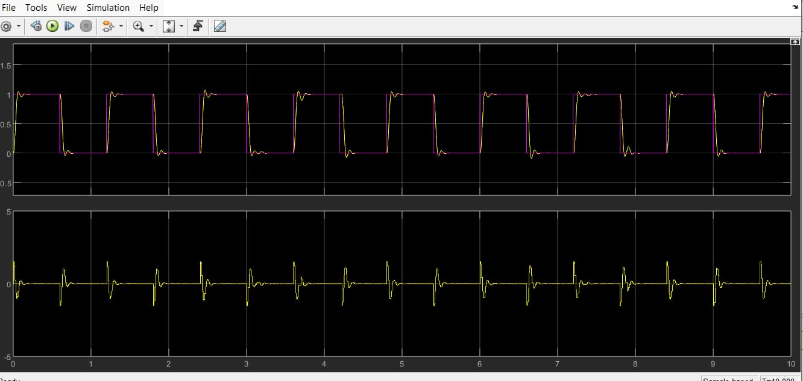
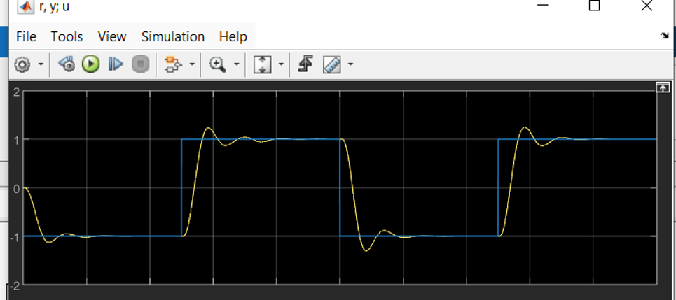
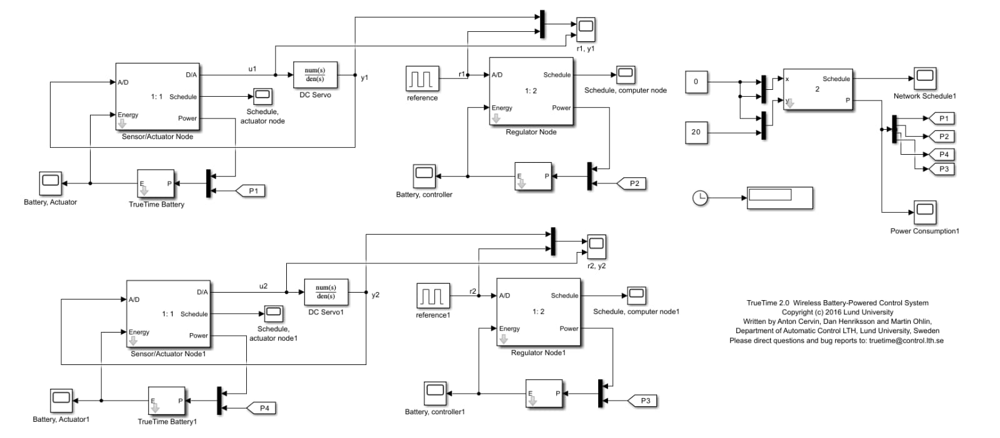
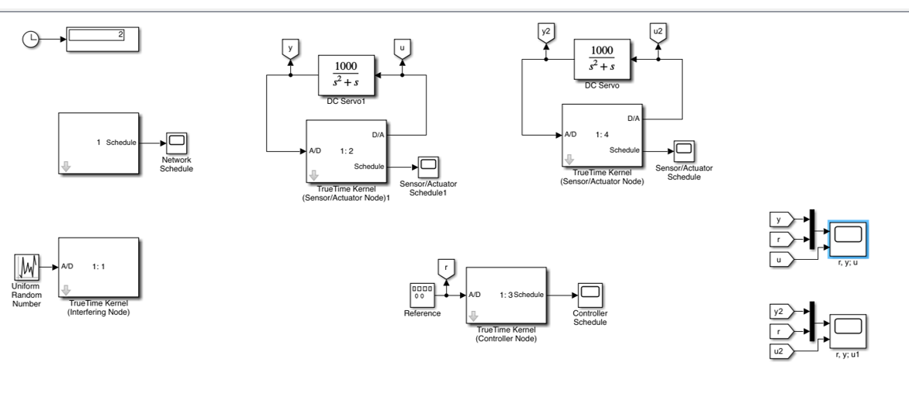

# Commande en réseau de deux servomoteurs avec TrueTime

Simulation sous **MATLAB/Simulink** et **[TrueTime](https://archive.control.lth.se/Research/tools/truetime.html)** de deux boucles de commande de servomoteurs DC fermées à travers un réseau. L'objectif est d'étudier l'effet des délais, de l'ordonnancement des tâches et de la qualité du réseau sur les performances de la commande, avec une période d'échantillonnage de 10 ms, et de procéder à l'**évaluation des performances temporelles/énergétiques**.

*Projet de formation d'ingénieur, ENIG, décembre 2024 – janvier 2025.*

## Deux scénarios

| Scénario | Dossier | Ce qui est étudié |
|---|---|---|
| **Réseau sans fil** | `wireless/` | Deux boucles de commande sur un réseau sans fil, nœuds alimentés par batterie, adaptation de la puissance d'émission |
| **Réseau avec interférences** | `networked/` | Deux boucles partageant un même nœud contrôleur, avec un nœud perturbateur générant du trafic aléatoire sur le réseau |

## Architecture

Dans les deux cas, chaque boucle est répartie sur des nœuds TrueTime qui communiquent par messages de 80 bits :

```
Servomoteur ──► Nœud capteur/actionneur ──(mesure y)──► Nœud contrôleur
      ▲                                                        │
      └──────────── commande u ◄───────────────────────────────┘
```

**Tâches (scénario sans fil)**

| Nœud | Tâche | Rôle | Temps d'exécution |
|---|---|---|---|
| Capteur/actionneur | `sens_task` (périodique, 10 ms) | Lit la mesure et l'envoie au contrôleur | 0,5 ms + 0,4 ms |
| Capteur/actionneur | `act_task` (sur réception) | Applique la commande reçue au servomoteur | 0,5 ms |
| Contrôleur | `pid_task` (sur réception) | Calcule la commande et l'envoie à l'actionneur | 0,5 ms |
| Les deux | `power_controller_task` (25 ms) | Adapte la puissance d'émission | 0,02 ms |

Ordonnancement à priorités fixes (`prioFP`) dans le scénario sans fil, à échéance monotone (`prioDM`) dans le scénario avec interférences.

Dans `networked/`, les deux boucles partagent le même nœud contrôleur : le gestionnaire réseau (`nwhandler_code.m`) lit l'identifiant du message pour déclencher la tâche contrôleur de la bonne boucle.

## Commande

Le régulateur est un correcteur **proportionnel-dérivé discret**, la dérivée étant calculée sur la mesure :

```
u[k] = K·(r[k] − y[k]) + D[k]
D[k] = ad·D[k−1] + bd·(y[k−1] − y[k])
ad = Td / (N·h + Td)        bd = N·K·Td / (N·h + Td)
```

| Paramètre | Valeur (scénario sans fil) |
|---|---|
| Période d'échantillonnage h | 10 ms |
| Gain proportionnel K | 1,5 |
| Temps dérivé Td | 0,035 s |
| Facteur de filtre N | 100 000 (dérivée quasi non filtrée, bd ≈ K·Td/h = 5,25) |

Pas d'action intégrale : le servomoteur modélisé (`1000 / (s² + s)` dans `networked/`) contient déjà un intégrateur, ce qui suffit pour annuler l'erreur statique sur un échelon.

## Gestion de l'énergie et de la puissance d'émission (scénario sans fil)

Chaque nœud est alimenté par une batterie TrueTime (consommation du noyau : 10 mW). Toutes les 25 ms, un nœud envoie un « ping » à l'autre :

- sans réponse : la puissance d'émission augmente de 10 dBm (maximum 30 dBm) ;
- avec réponse : elle diminue de 0,5 dBm, pour économiser l'énergie.

Puissance initiale : 20 dBm. Le but est de maintenir la liaison au moindre coût énergétique.

## Résultats

### Réseau sans fil



Référence en créneaux (0 ↔ 1) sur 10 s, sortie du servomoteur en jaune, commande en dessous. La sortie suit la référence avec un dépassement faible (environ 5 à 8 % d'après le tracé) et des oscillations amorties.

### Réseau avec interférences



Référence en créneaux (−1 ↔ 1). Le dépassement est plus marqué (environ 11 à 16 % de l'amplitude de l'échelon d'après le tracé) : les délais et les interférences sur le réseau dégradent l'amortissement de la boucle.

| Scénario | Dépassement observé |
|---|---|
| Sans fil | ≈ 5 à 8 % |
| Avec interférences | ≈ 11 à 16 % de l'amplitude de l'échelon |

*Valeurs estimées par lecture graphique des oscilloscopes Simulink.*

### Performances énergétiques (scénario sans fil)

Le modèle `wireless.slx` enregistre pour chaque nœud le niveau de batterie (oscilloscopes *Battery, Actuator* et *Battery, controller*) et la consommation du réseau (*Power Consumption*), ce qui permet d'évaluer l'effet de l'adaptation de la puissance d'émission sur l'énergie consommée en parallèle des performances temporelles.

### Modèles Simulink

| Sans fil | Avec interférences |
|---|---|
|  |  |

## Structure du dépôt

```
.
├── wireless/
│   ├── wireless.slx                 # modèle Simulink
│   ├── regulator_init.m             # nœud contrôleur : PD, tâches, batterie
│   ├── actuator_init.m              # nœud capteur/actionneur
│   ├── senscode.m, ctrlcode.m, actcode.m
│   ├── msgRcvCtrl.m, msgRcvActuator.m   # gestionnaires de réception réseau
│   └── powctrlcode.m, powrespcode.m     # adaptation de la puissance d'émission
├── networked/
│   ├── networked.mdl
│   ├── controller_init.m, sensor_actuator_init.m
│   ├── sensor_code.m, controller_code.m, actuator_code.m, nwhandler_code.m
│   ├── interference_init.m, interference_code.m   # nœud perturbateur
│   └── pidcalc.m
└── resultats/                       # captures de modèles et de réponses
```

## Exécution

**Prérequis :** MATLAB avec Simulink et la toolbox TrueTime 2.0.

1. Ajouter TrueTime au chemin MATLAB et lancer `init_truetime`.
2. Ouvrir `wireless/wireless.slx` ou `networked/networked.mdl` (les fichiers `*_init.m` sont appelés par les blocs TrueTime Kernel).
3. Lancer la simulation et observer les oscilloscopes de réponse et d'ordonnancement.

## Crédits

Les modèles et le code de base proviennent des exemples fournis avec TrueTime (« Wireless Battery-Powered Control System », Université de Lund, 2016). Ce projet les adapte à l'étude de deux boucles de commande de servomoteurs, avec :

- un nœud contrôleur partagé entre les deux boucles et un gestionnaire réseau qui aiguille les messages (`networked/`) ;
- un nœud perturbateur générant du trafic aléatoire (`interference_*.m`) ;
- l'adaptation du gestionnaire de réception `msgRcvCtrl.m` ;
- le réglage du correcteur et la comparaison des deux scénarios.

Référence : A. Cervin, D. Henriksson, B. Lincoln, J. Eker, K.-E. Årzén, *How Does Control Timing Affect Performance?*, IEEE Control Systems Magazine, 2003.

## Auteur

**Salem Amine Mlayeh**, élève ingénieur en Génie Électrique et Automatique (ENIG) · [GitHub](https://github.com/salemmlayeh)
